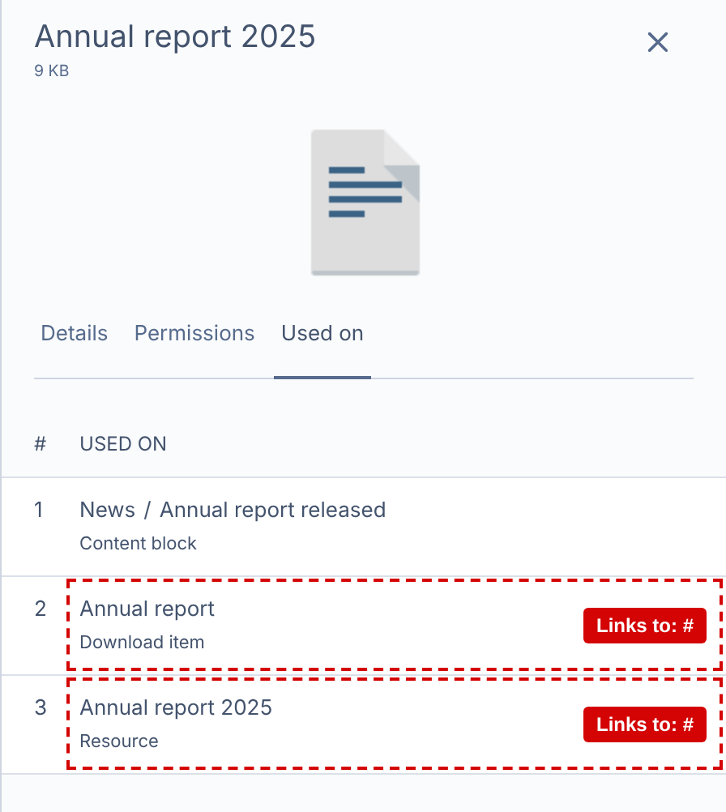
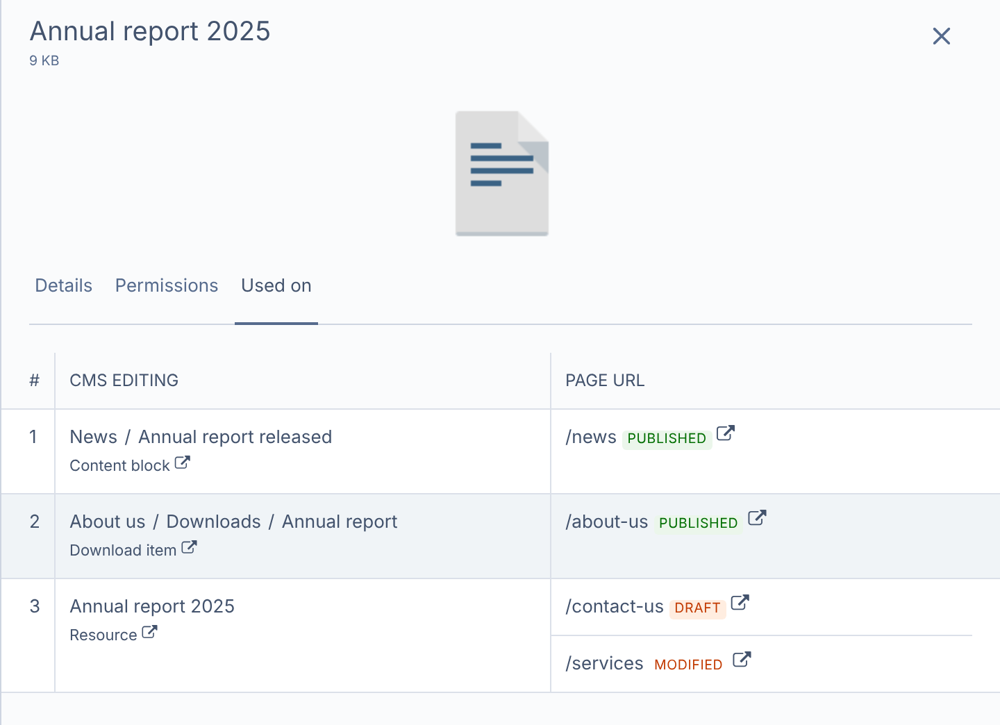

# Silverstripe Used On

Makes the "Used on" tab of files in Silverstripe CMS 6 tell you **where** a file is used, so you can find every
page it's on before you change or remove it.

| Without this module | With this module |
| --- | --- |
|  |  |

**Without it**, records other than pages and blocks, like an item in a list on a block, or a resource selected
by blocks, often have a broken link (`#`), and the tab doesn't say which page they're on.

**With it**, each usage:

- links to where it's edited in the CMS, even when that's inside a block or another record (on the right tab)
- shows its parents, ie. *About us / Downloads / Annual report*
- lists the page(s) it's on, with a link to view the page and its status: **Draft**, **Modified** or
  **Published**

## Installation

```sh
composer require normann/silverstripe-used-on
```

Then flush (`vendor/bin/sake flush`, or `?flush=1`).

Requires Silverstripe CMS 6 and PHP 8.3+.
[Elemental](https://github.com/silverstripe/silverstripe-elemental) and
[linkfield](https://github.com/silverstripe/silverstripe-linkfield) are optional: blocks and file links already
link correctly without this module, which covers the records on or behind them (ie. items in a list on a block).

## Setup

Pages and blocks need no setup; they get the "Page URL" column automatically. For your own records that use
files, apply one of two extensions, depending on how the record is edited:

| | `ManagedRecordExtension` | `SharedRecordExtension` |
| --- | --- | --- |
| **For** | Child records, edited in a GridField on their parent | Records used by other records, edited on their own |
| **Relation** | Has one parent (a `has_one`) | Used by many records (ie. selected by blocks on several pages) |
| **Example** | A download item in a list on a block | A resource in a ModelAdmin, featured by blocks |
| **Adds** | Its CMS edit link, parents, and page | Every page it's used on |

### Child records

```yaml
App\Blocks\DownloadItem:
  extensions:
    - Normann\UsedOn\Extensions\ManagedRecordExtension
```

The parent is found via the `Parent` has_one, and the GridField by looking through the parent's CMS fields.

### Shared records

```yaml
App\Models\Resource:
  extensions:
    - Normann\UsedOn\Extensions\SharedRecordExtension
    # Its CMS edit link, if it's edited in a ModelAdmin (core Silverstripe)
    - SilverStripe\Admin\CMSEditLinkExtension
  cms_edit_owner: App\Admin\ResourceAdmin
  # The relation(s) to the records using it, ie. has_many Blocks => ResourceBlock.Resource
  used_on_used_by: Blocks
```

The relation must be declared on this class (`has_many`, `many_many`, `belongs_many_many`), or be a method
returning the records. The records using it can be pages, blocks, child records, or other shared records.

## Options

| Option | Set on | Default | Description |
| --- | --- | --- | --- |
| `used_on_parent_relation` | Child records | `Parent` | The `has_one` relation to the parent |
| `used_on_grid_field` | Child records | Found automatically | The name of the GridField on the parent |
| `used_on_used_by` | Shared records | None | The relation, or list of relations, to the records using it |
| `page_column` | `Normann\UsedOn\Forms\UsedOnTable` | `true` | Show the "Page URL" column (and widen the file's pane to fit it) |
| `link_to_tab` | `Normann\UsedOn\Forms\UsedOnTable` | `true` | Link to the tab with the field using the file, ie. `#Root_Settings` |

## Good to know

- Links open in a new tab, so you stay on the file.
- Page links go to the draft site (`?stage=Stage`), so you see the latest version.
- A page is **Modified** if the page or anything on it (ie. its blocks) has unpublished changes.
- File links left behind by deleted records aren't used anywhere, so they're hidden.

## Development

```sh
composer install
npm install
npm run build   # Builds client/dist (committed)
npm test        # JavaScript tests
vendor/bin/phpunit  # PHP tests, with a database in .env
composer lint
```

`silverstripe/installer` is a dev dependency so the tests run from the module's root. JavaScript strings are
in `client/lang/src/` (run `npm run build:lang` after changing them).

## License

[BSD-3-Clause](LICENSE)
